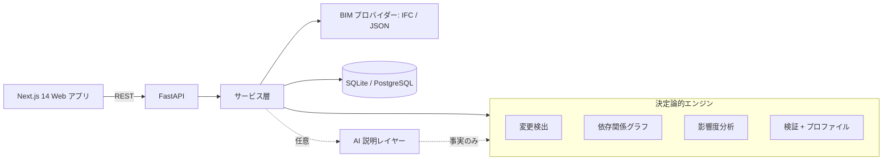

# BIMGuard

**BIM プロジェクトのための、決定論的な変更影響分析・発行可否判定エンジン**

[English README](README.md)

バージョン管理は「何が変わったか」を教えてくれます。BIMGuard は「その変更が何に影響するか」、そして「いま発行してよい状態か」を示します。BIM のリビジョン間の差分を検出し、文書間の型付き依存関係をたどり、説明可能な計算式で下流への影響度を算出します。さらに設定可能な検証ルールを適用し、`READY` / `READY_WITH_WARNINGS` / `BLOCKED` の発行可否を判定します。

オプションの AI レイヤーは、エンジンが出した結果の言い換えのみを行い、判断は一切行いません。AI に渡されるのは決定論的エンジンが生成した事実だけで、その事実に存在しない識別子を含む回答は破棄され、テンプレート回答に置き換えられます。AI を無効にしても、すべての機能を利用できます。

## 解決する課題

複数分野が関わるプロジェクトでは、壁 1 枚の移動が構造設計、数量拾い、設備配置に影響しますが、気付くのは手戻りコストが大きくなってからです。BIMGuard はこの波及を可視化して根拠とともに説明し、発行判断の条件として扱います。

## 主な機能

**決定論的コア**
- プロジェクト・文書・リビジョンのモデル(リビジョン履歴は不変)
- IFC(IfcOpenShell)と JSON のモデルプロバイダーによる、リビジョンごとの要素抽出
- リビジョン比較(追加・削除・変更・移動)
- 型付き・方向付きの依存関係グラフと、依存ごとのレビュー状態
- 影響度分析: `score = 100 × 依存 × 変更 × 伝播 × ステータス`。各係数と数値を当てはめた計算式を保存し、画面に表示
- 14 個の設定可能な検証ルール(依存の陳腐化、リビジョン欠落、命名規則、承認要否、空間干渉など)、理由付きの確認(acknowledge)、発行可否の判定
- 文書・プロジェクト単位の健全性(正常・注意・要確認・重大)と理由

**品質プロファイル**
- ルールの重大度・有効/無効・パラメータをプロジェクト単位で上書きする、バージョン付き YAML プロファイル
- 同梱プロファイルは `jp-bimcim-v1`(日本の BIM/CIM を想定)と `mfg-v1`(製造業)の 2 種類。どちらも*例示用*であり、公式の標準ではありません

**ワークフローと出力**
- 発行可否レポートを JSON・CSV・PDF で出力
- アプリ内通知と、追記専用の監査ログ
- 検証指摘の BCF 2.1 サブセット出力(`GET /validation-runs/{run_id}/bcf`)
- リビジョンの抽出済み要素の IFC4 出力。**ジオメトリは含まず**、QA やプロパティ確認用です(`docs/architecture/ifc-export.md` 参照)
- インタラクティブな依存関係グラフ、全体検索(Ctrl+K)、英語/日本語の言語切り替え

**セキュリティと運用**
- JWT 認証(`jti` によるログアウト失効)、再利用検知付きリフレッシュトークンのローテーション、セッション管理
- データベース方式のログイン試行回数制限
- ロールベースのアクセス制御(admin / BIM coordinator / engineer / reviewer / viewer)。ログインとヘルスチェック以外のすべてのルートが認証必須であることをテストで検証
- SQLite / PostgreSQL 向けのバックアップ・リストアスクリプト、差し替え可能なシークレットプロバイダー(環境変数、AWS Secrets Manager、Azure Key Vault)

## アーキテクチャ



エンジンはドメインオブジェクトを受け取って返すだけの純粋な Python パッケージです。サービス層が入力の読み込みと結果の保存を担当し、スキーマ変更は Alembic で管理しています。詳細は [`docs/architecture/system.md`](docs/architecture/system.md)、[`pipeline.md`](docs/architecture/pipeline.md)、[`ADR-004`](docs/decisions/ADR-004-deterministic-analysis-over-llm.md) を参照してください。

## 技術スタック

| 領域 | 技術 |
|---|---|
| バックエンド | Python 3.12、FastAPI、SQLAlchemy 2、Alembic、Pydantic 2 |
| BIM | IfcOpenShell、lxml |
| レポート | ReportLab |
| フロントエンド | Next.js 14、React 18、TypeScript、Tailwind CSS |
| データ | SQLite(開発・テスト)、PostgreSQL(対応) |
| テスト | pytest、Playwright |
| CI | GitHub Actions(バックエンドテスト、フロントエンドの型チェックとビルド、Playwright E2E、Docker Compose ビルド) |

## はじめに(Windows / PowerShell)

Python 3.11 以上(開発は 3.12)と Node.js(CI は 20)が必要です。

バックエンド:

```powershell
cd apps\api
python -m venv .venv
.\.venv\Scripts\Activate.ps1
pip install -e ".[dev]"
python -m alembic upgrade head
python -m app.seed
uvicorn app.main:app --reload
```

デフォルト設定ではローカルの SQLite ファイル(`bimguard_dev.db`)を使うため、`.env` は不要です。(`.env.example` には PostgreSQL 用の URL 例があります。)

別のターミナルでフロントエンド:

```powershell
cd apps\web
npm install
npm run dev
```

<http://localhost:3000> を開きます。API ドキュメントは <http://localhost:8000/docs> です。

仮想環境の作成と `npm install` が済んでいれば、`scripts\start.ps1` でマイグレーション、デモユーザー作成、両サーバーの起動をまとめて実行できます。

Docker Compose のファイル(`docker-compose.yml` と、任意のリバースプロキシ・Redis 用オーバーレイ)も用意しており、CI でビルドしています。ただし、Windows でのローカル開発では上記の手順を使用しています。

### デモアカウント

`python -m app.seed` は、開発専用のローカルデモユーザーを 3 つ作成します。

| ロール | メールアドレス | パスワード |
|---|---|---|
| Admin | `admin@example.local` | `admin-demo-pass` |
| Engineer | `engineer@example.local` | `engineer-demo-pass` |
| Reviewer | `reviewer@example.local` | `reviewer-demo-pass` |

これらの認証情報やデフォルトの `JWT_SECRET` を、ローカル環境以外で使用しないでください。`production` / `staging` 環境でデフォルトの JWT シークレットのまま起動すると、API は起動を拒否します。

### サンプルプロジェクトの読み込み

API を起動した状態で実行します。

```powershell
powershell -ExecutionPolicy Bypass -File .\scripts\load-sample-project.ps1 -WithArchitectureV2
```

合成データの「Factory Expansion - Building A」プロジェクト(文書 5 件、依存関係 5 件)を作成し、建築の第 2 リビジョンをアップロードして、変更検出、陳腐化した依存、影響が表示される状態にします。

サンプル IFC は `data/sample_ifc/`、製造業のサンプルは `data/sample_projects/factory_expansion/` にあります。操作手順は [`docs/demo.md`](docs/demo.md) を参照してください。

## テスト

バックエンド:

```powershell
cd apps\api
.\.venv\Scripts\python.exe -m pytest -q
```

`pytest --collect-only` では現在 **557 件**(53 ファイル)のテストが収集されます。これは収集数であり、成功数ではありません。CI ではプッシュのたびにスイートを実行しています。

フロントエンドの型チェックとビルド:

```powershell
cd apps\web
npx tsc --noEmit
npm run build
```

E2E(Playwright / Chromium): テストは `apps/web/e2e/` にあり、CI ではシード済みの SQLite データベースに対してヘッドレスで実行します。詳細は [`apps/web/e2e/README.md`](apps/web/e2e/README.md) を参照してください。

## 評価

`benchmark/dataset.json` は、7 つの検証ルールの適合率・再現率を確認するための小規模なラベル付きデータセットです。ラベルは作者が設計時に付与したものなので、実プロジェクトでの精度ではなく、ルールが仕様どおりに動作することを確認するものです。評価対象外のルールを含む詳細は [`docs/evaluation/`](docs/evaluation/) を参照してください。

## ドキュメント

- アーキテクチャ: [`docs/architecture/`](docs/architecture/)(影響度分析、検証エンジン、依存関係グラフ、プロファイル、認証、AI レイヤー、BCF、IFC 出力、バックアップ)
- API 仕様: [`docs/api/contract.md`](docs/api/contract.md)
- デモ手順: [`docs/demo.md`](docs/demo.md)
- 評価: [`docs/evaluation/`](docs/evaluation/)
- はじめに: [English](docs/en/getting-started.md) / [日本語](docs/ja/getting-started.md)
- 変更履歴: [`CHANGELOG.md`](CHANGELOG.md)

## 適用範囲と制約

BIMGuard はポートフォリオ向けのプロトタイプであり、本番運用の認証を受けた製品ではありません。

- 文書間の依存関係は利用者が登録したものに限られ、自動推定は行いません。
- 影響度の重みは妥当な初期値であり、実プロジェクトで校正したものではありません。要素の近接判定は平面視のみです。
- 同梱の品質プロファイルは例示用であり、日本の BIM/CIM や製造業の公式標準ではありません。
- IFC 出力はジオメトリを含まず、正式な IFC 納品物ではありません。BCF 出力は 2.1 のサブセットで、スナップショットやカメラ情報は含まず、外部の BCF ツールでの動作確認はこのリポジトリでは行っていません。
- シングルテナントです。認証済みのユーザーは全プロジェクトを閲覧でき、ロールで制御されるのは書き込みのみです。
- アプリケーション自体による保存データの暗号化は実装していません。[`docs/architecture/encryption.md`](docs/architecture/encryption.md) を参照してください。
- 検証ルールは全プロジェクト共通で、プロジェクトごとの上書きは未実装です。
- 日本語 UI の翻訳は一部のみです。[`docs/architecture/i18n.md`](docs/architecture/i18n.md) を参照してください。

## リポジトリ構成

```
apps/api      FastAPI バックエンド、エンジン、Alembic マイグレーション、テスト
apps/web      Next.js フロントエンドと Playwright E2E
data          サンプル IFC / JSON プロジェクト
benchmark     ラベル付き評価データセット
docs          アーキテクチャ、評価、運用、デモ
scripts       PowerShell / Python の補助スクリプト
```
