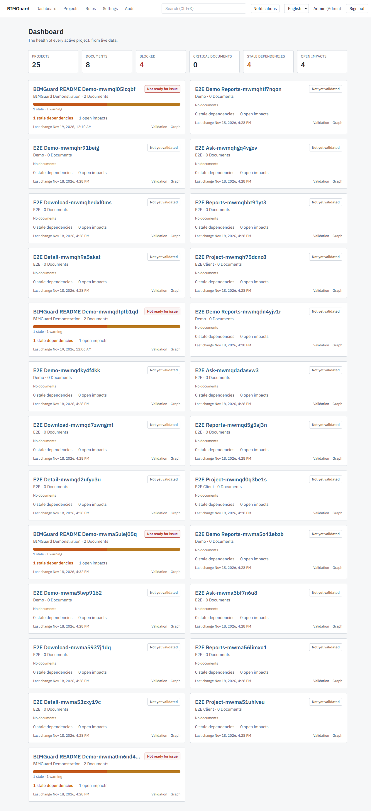
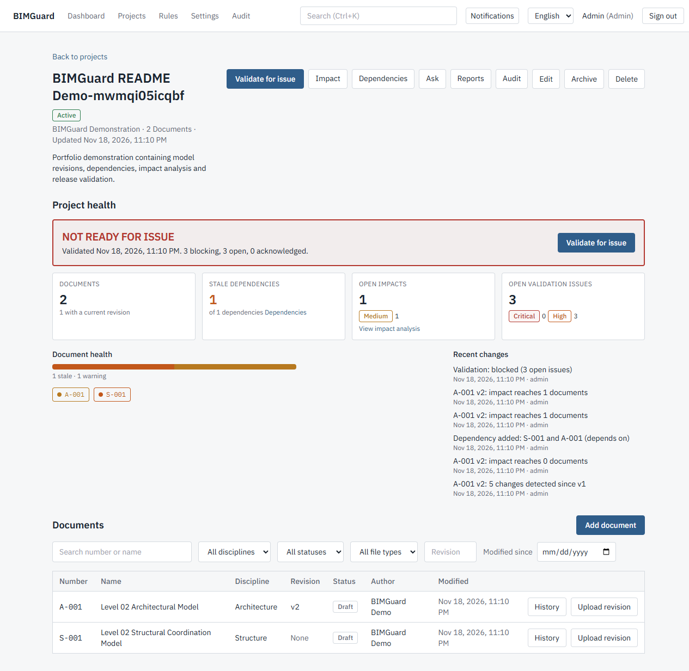
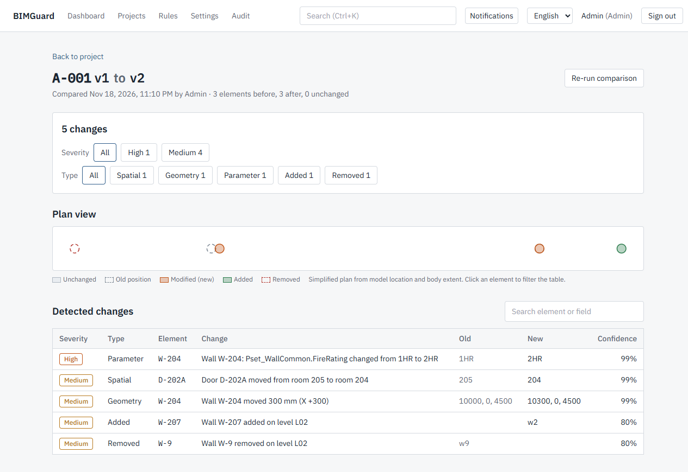
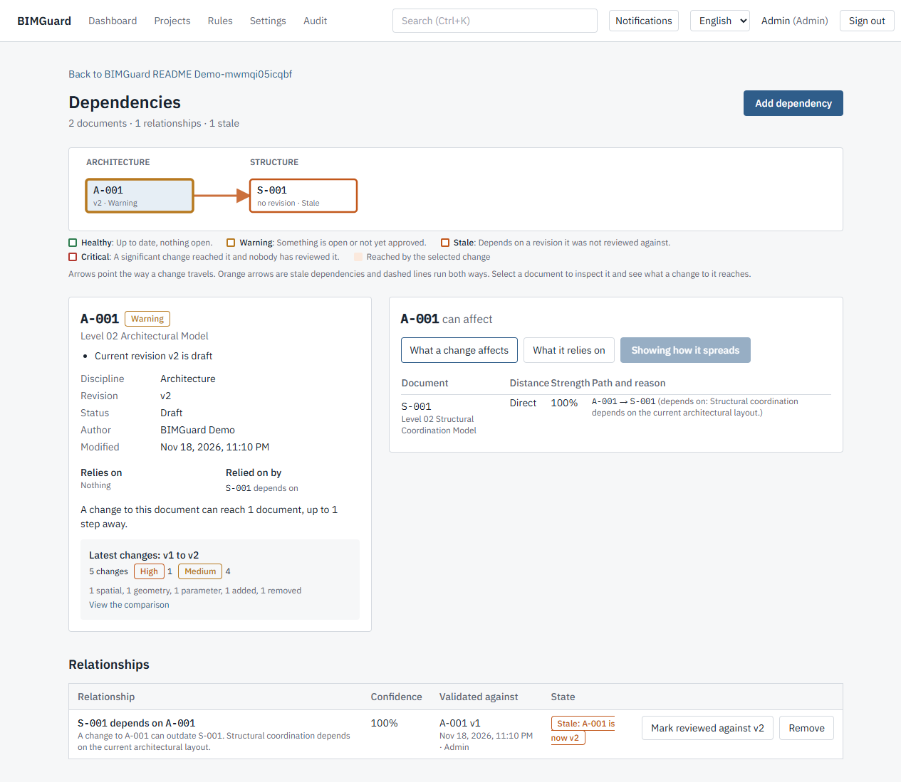
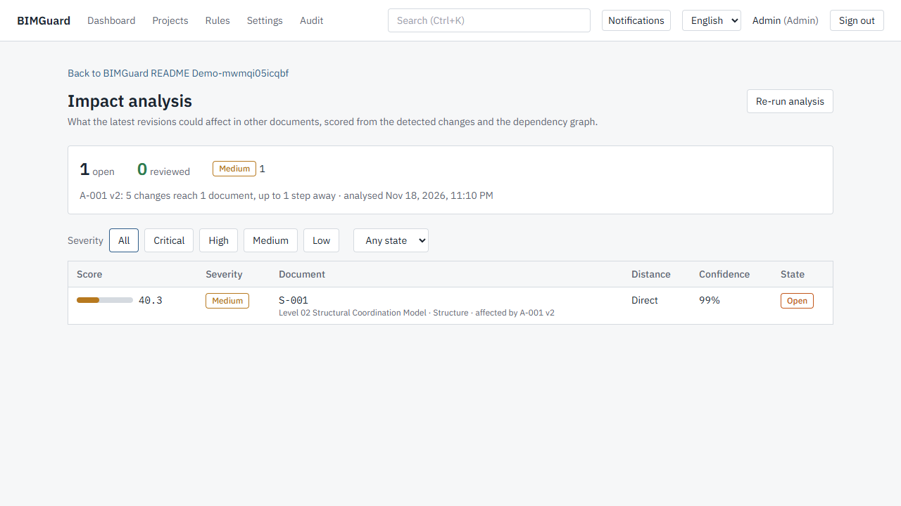
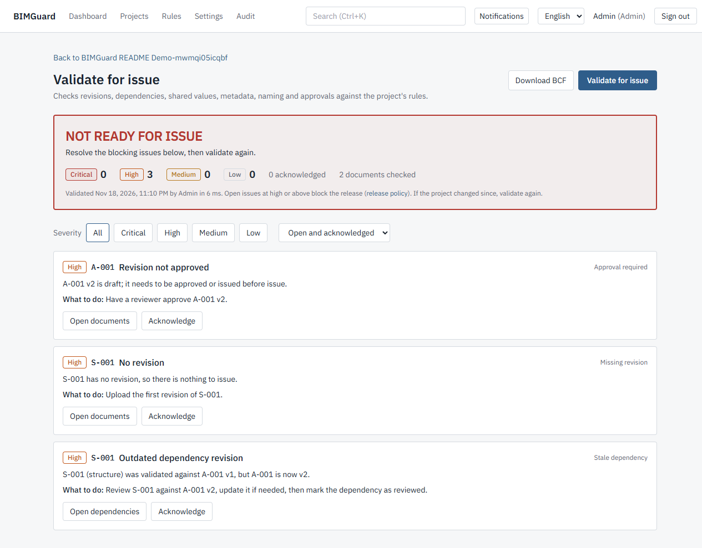
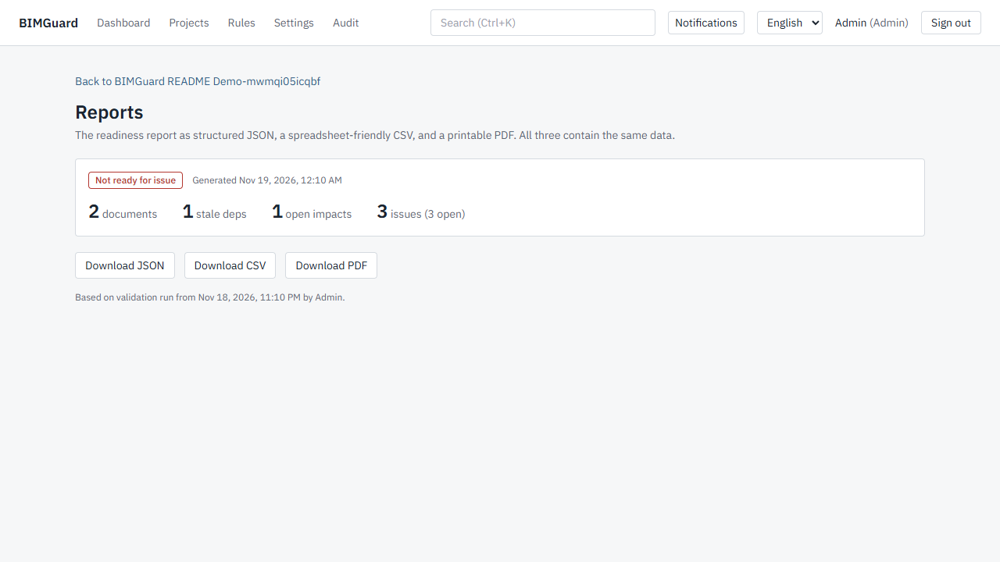
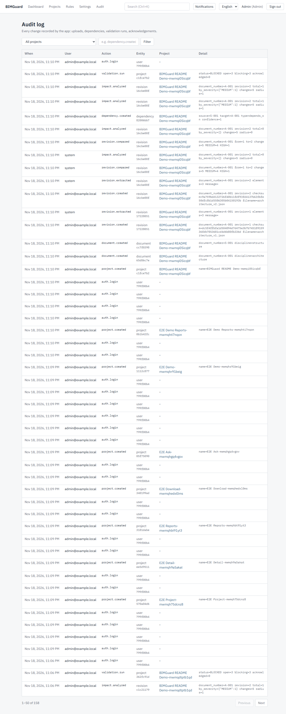
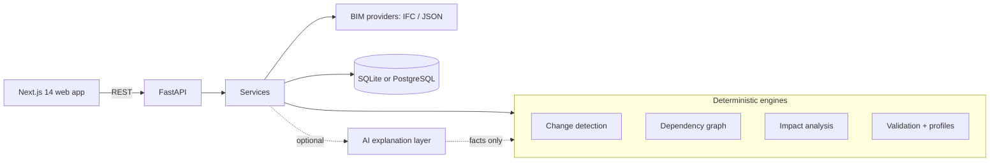

# BIMGuard

**Deterministic change-impact and release-readiness checks for BIM projects.**

[日本語版 README](README.ja.md)

Version control tells you *what* changed. BIMGuard tells you *what that change could affect* and whether the project is ready to issue. It compares BIM revisions, follows typed dependencies between documents, scores downstream impact with an explainable formula, applies configurable validation rules, and returns a release-readiness verdict: `READY`, `READY_WITH_WARNINGS`, or `BLOCKED`.

An optional AI layer can reword the engine's answers. It never makes decisions: it receives only facts produced by the deterministic engines, and any reply that mentions an identifier not present in those facts is discarded in favour of a template answer. The product is fully usable with AI turned off.

## Product walkthrough

The screenshots below show a populated BIMGuard demonstration workflow, generated by the Playwright end-to-end suite using an isolated test database and synthetic project data.

The walkthrough follows a model change from initial project visibility through dependency analysis, release validation and audit history.

| Project overview | Revision comparison |
|---|---|
| **1. Dashboard** — project overview and current activity. | **2. Project detail** — documents, revisions and project health. |
|  |  |
| **3. Model comparison** — five detected changes between architecture revisions, including added, removed, spatial, geometry and parameter changes. | **4. Dependency graph** — registered document relationships and the stale dependency after the architecture revision changes. |
|  |  |
| **5. Impact analysis** — downstream documents reached by a change, with explainable impact information. | **6. Release validation** — validation results and issues used to determine release readiness. |
|  |  |
| **7. Readiness report** — a consolidated view of project readiness and findings. | **8. Audit log** — recorded activity for traceability. |
|  |  |

The demonstration data is synthetic. These screenshots illustrate application behavior and are not evidence of validation against a live construction project or an external BIM standard.


## The problem

On a multi-discipline project, one moved wall can invalidate a structural design, a quantity take-off and an MEP layout, and nobody notices until it is expensive. BIMGuard makes that propagation visible, explains it, and gates issuing on it.

## Key capabilities

**Deterministic core**
- Project / document / revision model with immutable revision history
- IFC (IfcOpenShell) and JSON model providers that extract elements per revision
- Revision comparison: added, removed, modified and moved elements
- Typed, directional dependency graph with per-dependency review state
- Impact analysis: `score = 100 × dependency × change × propagation × status`, with every factor and the filled-in formula stored and shown
- Validation engine with 14 configurable rules (stale dependency, missing revision, naming convention, approval required, spatial conflict, and others), acknowledgement with written reason, and a readiness decision
- Per-document and project health (Healthy / Warning / Stale / Critical) with reasons

**Quality profiles**
- Versioned YAML profiles that override rule severity, enablement and parameters per project
- Two bundled profiles: `jp-bimcim-v1` (Japanese BIM/CIM oriented) and `mfg-v1` (manufacturing). Both are marked *illustrative*; they are not official standards

**Workflow and outputs**
- Readiness reports as JSON, CSV and PDF
- In-app notifications and an append-only audit log
- BCF 2.1 subset export of validation issues (`GET /validation-runs/{run_id}/bcf`)
- IFC4 export of a revision's extracted elements, **without geometry**, intended for QA and property review (see `docs/architecture/ifc-export.md`)
- Interactive dependency graph, global search (Ctrl+K), English/Japanese language switcher

**Security and operations**
- JWT authentication with `jti`-based logout revocation, refresh-token rotation with reuse detection, and session management
- Database-backed login rate limiting
- Role-based access (admin, BIM coordinator, engineer, reviewer, viewer), with a test that every route requires authentication except login and health
- Backup/restore scripts for SQLite and PostgreSQL; pluggable secret providers (environment, AWS Secrets Manager, Azure Key Vault)

## Architecture



The engines are plain Python packages that take domain objects and return domain objects; the services layer loads inputs and stores results. Schema changes are managed with Alembic. More detail: [`docs/architecture/system.md`](docs/architecture/system.md), [`pipeline.md`](docs/architecture/pipeline.md), [`ADR-004`](docs/decisions/ADR-004-deterministic-analysis-over-llm.md).

## Technology stack

| Area | Technology |
|---|---|
| Backend | Python 3.12, FastAPI, SQLAlchemy 2, Alembic, Pydantic 2 |
| BIM | IfcOpenShell, lxml |
| Reports | ReportLab |
| Frontend | Next.js 14, React 18, TypeScript, Tailwind CSS |
| Data | SQLite (development / tests), PostgreSQL (supported) |
| Tests | pytest, Playwright |
| CI | GitHub Actions (backend tests, frontend typecheck and build, Playwright E2E, Docker Compose build) |

## Getting started (Windows, PowerShell)

Requires Python 3.11+ (developed on 3.12) and Node.js (CI uses 20).

Backend:

```powershell
cd apps\api
python -m venv .venv
.\.venv\Scripts\Activate.ps1
pip install -e ".[dev]"
python -m alembic upgrade head
python -m app.seed
uvicorn app.main:app --reload
```

The default configuration uses a local SQLite file (`bimguard_dev.db`), so no `.env` file is needed. (`.env.example` shows a PostgreSQL URL for those who want it.)

Frontend, in a second terminal:

```powershell
cd apps\web
npm install
npm run dev
```

Open <http://localhost:3000>. API docs are at <http://localhost:8000/docs>.

Once the virtual environment and `npm install` are done, `scripts\start.ps1` does the migration, seeding and launch of both servers in one step.

Docker Compose files are included (`docker-compose.yml`, plus optional reverse-proxy and Redis overlays) and are built in CI, but the quick start above is the path used for local development on Windows.

### Demo accounts

`python -m app.seed` creates three local demo users, for development only:

| Role | Email | Password |
|---|---|---|
| Admin | `admin@example.local` | `admin-demo-pass` |
| Engineer | `engineer@example.local` | `engineer-demo-pass` |
| Reviewer | `reviewer@example.local` | `reviewer-demo-pass` |

Do not use these credentials or the default `JWT_SECRET` outside a local environment. The API refuses to start in `production`/`staging` with a default JWT secret.

### Load the sample project

With the API running:

```powershell
powershell -ExecutionPolicy Bypass -File .\scripts\load-sample-project.ps1 -WithArchitectureV2
```

This creates a synthetic "Factory Expansion - Building A" project with five documents and five dependencies, then uploads a second architecture revision so that changes, stale dependencies and impacts appear.

The sample IFC files are in `data/sample_ifc/`, and a manufacturing sample in `data/sample_projects/factory_expansion/`. A guided walkthrough is in [`docs/demo.md`](docs/demo.md).

## Testing

Backend:

```powershell
cd apps\api
.\.venv\Scripts\python.exe -m pytest -q
```

`pytest --collect-only` currently collects **557** tests across 53 files. Collection is not a pass count; the CI workflow runs the suite on every push.

Frontend type check and build:

```powershell
cd apps\web
npx tsc --noEmit
npm run build
```

End-to-end (Playwright, Chromium): the specs live in `apps/web/e2e/` and CI runs them headless against a freshly seeded SQLite database. See [`apps/web/e2e/README.md`](apps/web/e2e/README.md).

## Evaluation

`benchmark/dataset.json` is a small labelled dataset used to check seven validation rules for precision and recall. The labels are written by design by the author, so this measures that the rules behave as specified, not accuracy on real projects. Details and the rules that are *not* measured: [`docs/evaluation/`](docs/evaluation/).

## Documentation

- Architecture: [`docs/architecture/`](docs/architecture/) (impact analysis, validation engine, dependency graph, profiles, auth, AI layer, BCF, IFC export, backup)
- API contract: [`docs/api/contract.md`](docs/api/contract.md)
- Demo script: [`docs/demo.md`](docs/demo.md)
- Evaluation: [`docs/evaluation/`](docs/evaluation/)
- Getting started: [English](docs/en/getting-started.md) / [日本語](docs/ja/getting-started.md)
- Changelog: [`CHANGELOG.md`](CHANGELOG.md)

## Scope and limitations

BIMGuard is a portfolio-grade prototype, not a production-certified product.

- Dependencies between documents are the ones people register; nothing is inferred.
- Impact weights are reasonable defaults, not calibrated on real projects. Element proximity is plan-view only.
- The bundled quality profiles are illustrative, not official Japanese BIM/CIM or manufacturing standards.
- IFC export carries no geometry and is not a compliant IFC submission. BCF export is a 2.1 subset with no snapshots or camera data and has not been checked against external BCF tools in this repository.
- Single-tenant: any authenticated user can read every project; roles control writes.
- No encryption at rest is implemented by the application. See [`docs/architecture/encryption.md`](docs/architecture/encryption.md).
- Validation rules are global; per-project rule overrides are not implemented.
- Japanese UI translation is partial. See [`docs/architecture/i18n.md`](docs/architecture/i18n.md).

## Repository layout

```
apps/api      FastAPI backend, engines, Alembic migrations, tests
apps/web      Next.js frontend and Playwright E2E specs
data          Sample IFC and JSON projects
benchmark     Labelled evaluation dataset
docs          Architecture, evaluation, operations, demo
scripts       PowerShell and Python helper scripts
```
