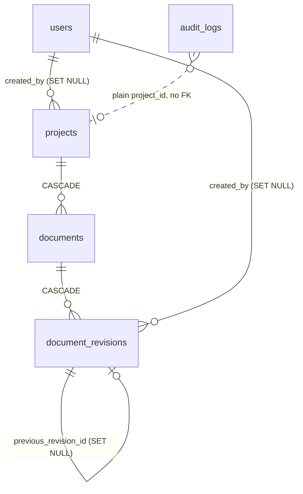

# Database (through Milestone 2)

- `documents`: unique `(project_id, document_number)`; `current_revision_number` is denormalised and
  maintained by the revision service.
- `document_revisions`: unique `(document_id, revision_number)`; index on `(document_id, checksum)` for
  duplicate detection. Only `status` may change after insert: an ORM `before_update` guard raises
  `ImmutableRevisionError` for any other field. Superseding the previous revision is a status change.
- `audit_logs`: append-only and intentionally without foreign keys so history survives deletions.
- Files live on disk under `STORAGE_DIR/<project_id>/<document_id>/<random>.<ext>`; the original filename is
  stored as sanitised metadata only and never used as a path.
- Migrations: Alembic (`apps/api/alembic`). Never edit a committed migration; add a new one.
